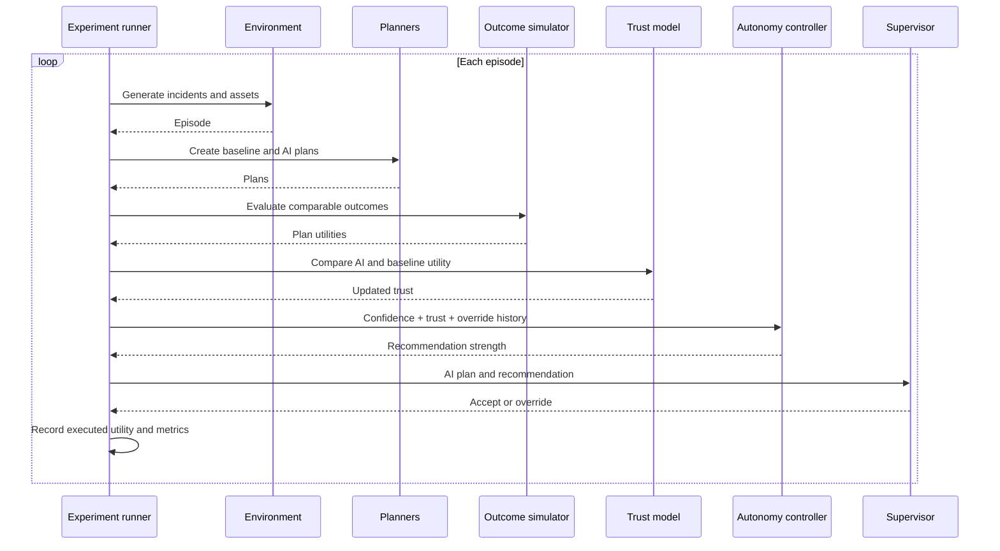
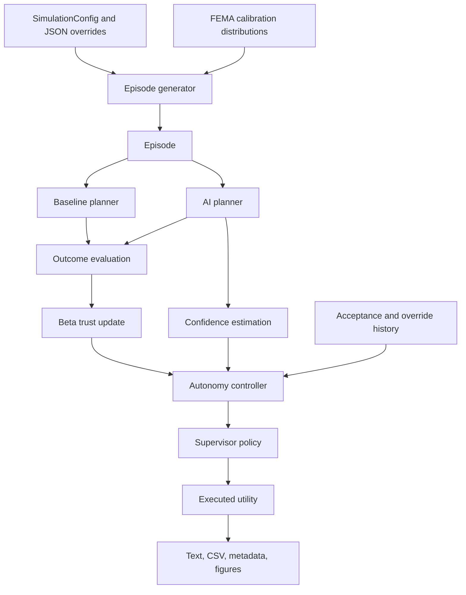

# System Architecture

The system is a pipeline of small, interpretable components. Experiment
orchestration coordinates them but does not merge their responsibilities.

## Data flow

## Design properties

- **Modularity:** generation, planning, evaluation, trust, autonomy, and
  supervision can be tested independently.
- **Interpretability:** planners use greedy heuristics and the controller uses a
  transparent weighted score.
- **Reproducibility:** explicit seeds and resolved configuration values are
  written with multi-seed output.
- **Comparability:** paired conditions reuse seed structure to reduce
  uncontrolled variation.

Continue to [Components](components.md) for module-level responsibilities.
