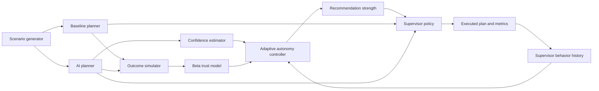

---
hide:
  - navigation
  - toc
---

# Trust-Aware Adaptive Autonomy

<div class="grid cards" markdown>

-   :material-account-group:{ .lg .middle } **Human-machine teaming**

    ---

    Study how an autonomy controller can regulate reliance when a supervisor
    undertrusts, appropriately trusts, or overtrusts an AI teammate.

-   :material-tune-variant:{ .lg .middle } **Behavior-aware adaptation**

    ---

    Change recommendation strength using AI confidence, estimated trust, and
    observed supervisor behavior.

-   :material-chart-box-outline:{ .lg .middle } **Reproducible experiments**

    ---

    Run single-seed demonstrations, Monte Carlo studies, ablations, and
    sensitivity analyses with recorded metadata.

</div>

Trust-Aware Adaptive Autonomy is a simulation framework for research on
resource allocation under uncertainty. In each episode, an AI planner and a
supervisor-oriented baseline propose plans for a disaster-response-inspired
environment. A simulated supervisor then accepts or overrides the AI
recommendation while the system updates its estimate of AI helpfulness.

[Get started](user-guide/getting-started.md){ .md-button .md-button--primary }
[Explore the research](overview/index.md){ .md-button }

## System at a glance



The controller adjusts *how strongly* a plan is recommended without hiding the
underlying planning decision. This makes the intervention mechanism
interpretable and independently testable.

## Quick start

```bash
git clone https://github.com/thebrianjdavis/Trust-Aware-Adaptive-Autonomy.git
cd Trust-Aware-Adaptive-Autonomy
python -m venv .venv
source .venv/bin/activate
python -m pip install -r requirements.txt
python main.py --mode single-seed --study standard --episodes 100 --visualize
```

Results are written below `results/single_seed/` or `results/multi_seed/`,
depending on the selected run mode.

## Key research contributions

1. **Reliance regulation as a control problem.** The project treats observable
   acceptance and override behavior as a signal that can inform autonomy.
2. **Interpretable intervention.** A weighted controller maps confidence, trust,
   and behavior to weak, normal, or strong recommendations.
3. **Controlled comparison.** Standard, ablation, and scenario-sensitivity
   studies isolate when adaptation changes behavior and when that change
   improves utility.
4. **Data-grounded simulation.** FEMA incident frequencies and durations shape
   the environment while explicitly modeled stochastic processes provide
   task-level uncertainty.

## Where to go next

<div class="grid cards" markdown>

-   **Understand the model**

    [Trust and reliance](concepts/trust-and-reliance.md) ·
    [Adaptive autonomy](concepts/adaptive-autonomy.md)

-   **Inspect the implementation**

    [Architecture](architecture/index.md) ·
    [Python API](api-reference/index.md)

-   **Run a study**

    [Experiment design](experiments/index.md) ·
    [Command guide](user-guide/running-experiments.md)

-   **Interpret evidence**

    [Results](results/index.md) ·
    [Data grounding](concepts/data-grounding.md)

</div>
