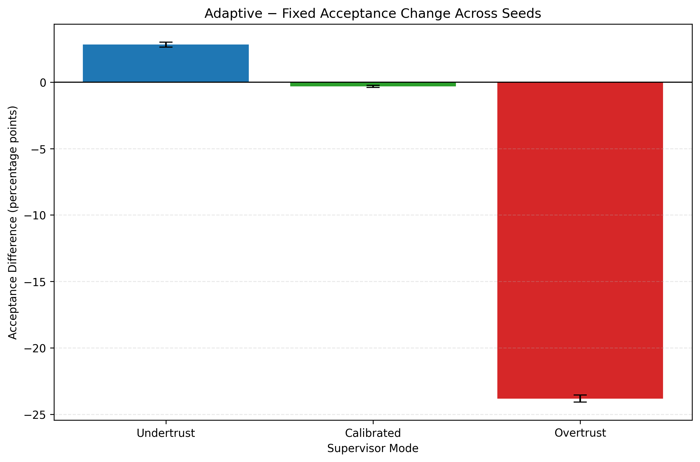

# Research Impact

## Why This Research Matters

Human–AI teams can perform poorly when reliance is miscalibrated. Undertrust can
cause useful recommendations to be ignored, while overtrust can cause weak
recommendations to be accepted too readily. A capable planner alone does not
solve this problem; an intelligent system must also reason about how strongly
it should intervene and how the human teammate is responding.

This project studies whether adaptive recommendation strength can regulate
reliance while preserving or improving team performance.

## Research Contributions

The framework supports investigation of five research contributions:

1. **Behavior-aware adaptive autonomy.** A controller combines AI confidence, a
   machine-side trust estimate, and observed supervisor behavior to adjust
   recommendation strength.
2. **Separation of reliance and performance outcomes.** The experimental design
   distinguishes successful regulation of acceptance behavior from improvements
   in executed utility.
3. **Interpretable human–machine teaming models.** Explicit planners, trust
   updates, supervisor policies, and intervention rules can be inspected and
   ablated.
4. **Reproducible experimentation.** Configuration-driven studies,
   deterministic seed ranges, structured output artifacts, and run metadata
   support Monte Carlo, ablation, and sensitivity analyses.
5. **Hybrid empirical and simulated grounding.** FEMA disaster-declaration data
   grounds selected environmental characteristics, while the documentation
   identifies which task and outcome variables remain modeled.

These are contributions of the framework and research claims investigated by
the project, not a statement that every contribution has been validated through
peer review or human-subject study.

## Current Evidence

!!! abstract "Current simulation-based evidence"

    **Adaptive autonomy can robustly regulate simulated reliance behavior, but
    performance gains depend on AI reliability and scenario conditions.**

- Undertrust policies generally receive stronger intervention.
- Overtrust policies generally receive weaker intervention.
- Calibrated policies remain comparatively stable.
- Utility effects are conditional rather than universally positive.
- These findings are based on simulated supervisors and should not be
  interpreted as human-subject validation.

<figure class="impact-figure" markdown>

<figcaption markdown>
Adaptive-minus-fixed acceptance change in the standard baseline study across
250 deterministic seeds; error bars show 95% confidence intervals. The figure
illustrates simulated reliance regulation, not human-subject behavior. See the
[detailed Results section](../results/index.md) for interpretation.
</figcaption>

</figure>

## Potential Application Domains

The mechanism may be relevant wherever a person supervises uncertain automated
recommendations, including:

- disaster response;
- emergency management;
- operational planning;
- logistics and resource allocation;
- critical-infrastructure decision support;
- healthcare operations;
- defense decision support.

These are **potential transfer domains**. The current simulator does not
validate the method in any of them beyond its disaster-response-inspired
scenario.

## Limitations of the Current Evidence

| Area | Current scope | Implication |
|---|---|---|
| Supervisors | Simulated undertrust, calibrated, and overtrust policies | Results do not establish how people would respond; see [detailed limitations](../results/index.md#limitations). |
| Task priorities | Priorities are modeled rather than derived from FEMA | Utility reflects an experimental value model, not observed operational priorities. |
| Success probabilities | Beta-distributed probabilities are modeled | Outcomes are controlled stochastic realizations rather than learned field estimates; see [Data Grounding](../concepts/data-grounding.md). |
| AI planning | Interpretable heuristic planner | Results do not establish performance against a globally optimized planner; see [Components](../architecture/components.md#planners). |
| Trust | Machine-side Beta estimate of AI helpfulness | The state is not a complete psychological model or direct measurement of human trust; see [Trust and Reliance](../concepts/trust-and-reliance.md). |
| FEMA grounding | Incident types and durations are empirically grounded | Task priorities, success probabilities, and operational outcomes remain modeled. |
| Evaluation setting | Controlled simulation rather than field deployment | Claims are limited to the implemented scenarios and experimental design. |

## Future Research

Appropriately qualified next steps include:

- human-subject validation;
- richer behavioral trust models;
- longitudinal and dynamically changing supervisor policies;
- alternative trust-update mechanisms;
- learned or optimized planning approaches;
- explainable recommendation strategies;
- additional operational domains;
- broader scenario-sensitivity studies;
- formal statistical testing and effect-size reporting.

The [study design](../experiments/index.md) describes the current methodology,
while the [Results](../results/index.md) page separates present evidence from
future claims. Reproducing or citing a result should include the configuration,
episode and seed counts, seed range, policies, autonomy modes, and associated
metadata; see the [reproducibility checklist](../user-guide/running-experiments.md#reproducibility-checklist)
and [reporting and citation guidance](../results/index.md#reporting-and-citation-guidance).
